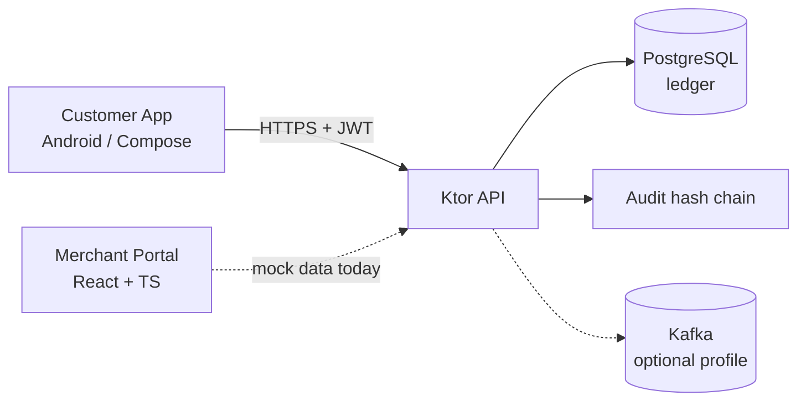

# PayFriend

> A C2B (Customer-to-Business) Android payment platform **scaffold**, designed with MAS-compliance readiness and tamper-evident audit trails in mind.

[](https://github.com/hiking1/PayFriend/actions/workflows/ci.yml)
[](https://opensource.org/licenses/MIT)
[](https://kotlinlang.org/)
[](https://ktor.io/)

---

## ⚠️ Important Disclaimer

**PayFriend is a technical demonstration and scaffold. It is NOT a licensed payment service.**

- No real money movement is implemented
- No MAS licence is held
- Customer funds are NOT safeguarded
- Intended for **technology evaluation, acquisition, or partnership discussions** with licensed Payment Service Institutions

## 🎯 What this is

| Component | Status | Notes |
| --- | --- | --- |
| Customer Android app (Jetpack Compose) | ✅ Scaffolded | Crypto-bound biometric confirmation, QR scan (CameraX + ML Kit), wallet + history |
| Backend API (Ktor) | ✅ Scaffolded | Double-entry ledger, idempotent payments, JWT auth, hash-chained audit log |
| Persistence | ✅ Optional | In-memory by default; PostgreSQL via Exposed when `DB_URL` is set |
| Merchant portal (React + TypeScript) | ✅ Scaffolded | Sales analytics, QR generation, transaction list. **Runs on mock data** |
| MAS compliance scaffold | 📝 Documented | Indicative control mapping in `docs/MAS_COMPLIANCE_GAP.md` (not legal advice) |
| Real payment rails (PayNow, FAST) | ❌ Mocked | Would require an appropriate MAS licence and bank partnerships |
| KYC / Singpass | ❌ Mocked | `POST /api/v1/auth/demo-login` is a demo stub |

## 🏗️ Architecture



See `docs/ARCHITECTURE.md` and `docs/C4_DIAGRAMS.md` for detail.

## 🚀 Quick start

### 1. Backend (no database needed)

Requires JDK 17 and Gradle 8.9+ (or run `gradle wrapper` once inside `backend/`).

```bash
cd backend
gradle test          # runs without Postgres
gradle run           # http://localhost:8080/health
```

With PostgreSQL:

```bash
docker compose up -d postgres
DB_URL=jdbc:postgresql://localhost:5432/payfriend DB_USER=payfriend DB_PASSWORD=payfriend_dev gradle run
```

### 2. Android app

1. Open the repository root in Android Studio (Koala or newer, JDK 17).
2. Let Gradle sync, then run the `app` configuration on an emulator.
   The emulator reaches the backend at `http://10.0.2.2:8080/`.
3. Enroll a fingerprint in the emulator (Settings → Security) or use the debug-only sign-in button.
4. Tap **Scan to Pay**. In debug builds you can paste test QR text instead of using the camera:

```
PAYFRIEND|MERCH-001|PayFriend_Demo_Cafe|201912345A|12.50
```

The launcher icon is the stock Android placeholder. Replace it via *File → New → Image Asset*.

### 3. Merchant portal

```bash
cd merchant-portal
npm install
npm run dev          # http://localhost:5173  (demo login: merchant@payfriend.demo / any password)
```

Commit the generated `package-lock.json` afterwards.

## 🔳 QR payload format

`PAYFRIEND|<merchantId>|<merchantName with _ for spaces>|<UEN>|<amount or empty>`

The merchant portal generates exactly this format; the app parses it in `QrPaymentData.parse()`.
An empty amount means the customer types the amount.

## 🔐 Security notes

- Biometric confirmation uses a Keystore key that requires user authentication for every use (`CryptoObject`), not a bare success callback.
- Cleartext HTTP is enabled for debug builds only (emulator loopback).
- Payments carry an idempotency key; replays return the original result, conflicting reuse returns `409`.
- Everything labelled *demo* (login, JWT secret default, funding) must be replaced before any real use.

## 📁 Layout

```
app/              Android customer app
backend/          Ktor API (separate Gradle build)
merchant-portal/  React + Vite + Tailwind
docs/             Architecture, compliance gap analysis, API spec, C4 diagrams
mock/mas/         MockServer config for mocked rails
```

## License

MIT for the source code only. See `LICENSE` for the regulatory notice.
