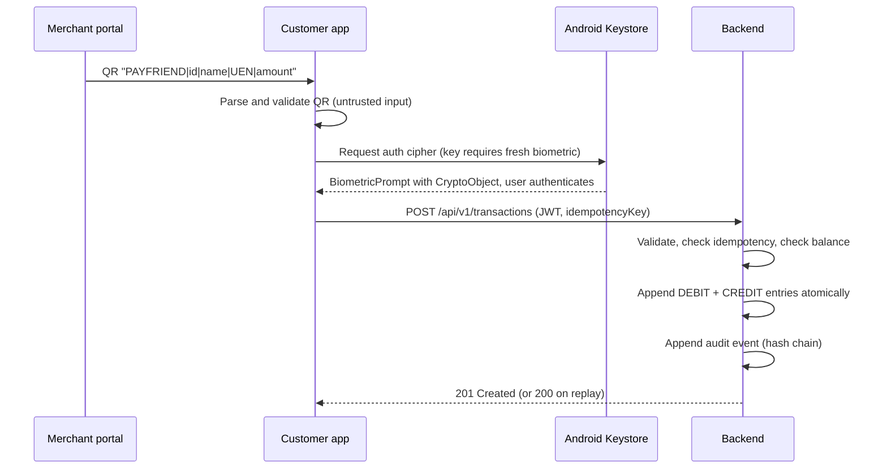

# PayFriend Architecture

PayFriend is a scaffold of a Singapore-focused C2B payment platform. It is a technology demonstration: no real money moves and nothing here is a licensed payment service.

## Components

| Component | Tech | Responsibility |
| --- | --- | --- |
| Customer app (`app/`) | Kotlin, Jetpack Compose, Hilt, Retrofit, CameraX, ML Kit | Biometric sign-in, QR scan, payment confirmation, wallet and history |
| Backend (`backend/`) | Kotlin, Ktor 2.3, Exposed, PostgreSQL | Auth (demo), double-entry ledger, idempotent payments, audit chain |
| Merchant portal (`merchant-portal/`) | React 18, TypeScript, Vite, Tailwind, Recharts | Sales overview, transaction list, payment QR generation (mock data) |
| Infra (`docker-compose.yml`) | PostgreSQL, Redis, optional Kafka | Local development stack |

## Payment flow



## Ledger design

- **Double entry.** A payment writes exactly two `ledger_entries` rows: a DEBIT on the payer wallet and a CREDIT on `merchant:<id>`, for the same amount and `transaction_id`.
- **Append-only.** The repository interface has no update or delete. Corrections are compensating entries.
- **Money as integers.** Amounts are `Long` cents. No floating point.
- **Balances are derived** from entries (credits minus debits), never stored.
- **Idempotency.** `idempotency_key` is unique. Replaying the same key and payload returns the original transaction (HTTP 200). The same key with a different payload returns 409.

### Enforcing immutability in PostgreSQL (recommended hardening)

The application never updates ledger rows, but the database can enforce it too:

```sql
CREATE FUNCTION forbid_mutation() RETURNS trigger AS $$
BEGIN RAISE EXCEPTION 'ledger is append-only'; END;
$$ LANGUAGE plpgsql;

CREATE TRIGGER ledger_entries_immutable
  BEFORE UPDATE OR DELETE ON ledger_entries
  FOR EACH ROW EXECUTE FUNCTION forbid_mutation();

CREATE TRIGGER transactions_immutable
  BEFORE UPDATE OR DELETE ON transactions
  FOR EACH ROW EXECUTE FUNCTION forbid_mutation();
```

## Audit trail

`AuditService` keeps a hash chain: each event's SHA-256 covers its own fields (length-prefixed) plus the previous event's hash. `GET /health` reports `auditChainValid`. Editing or removing any past event breaks every later link.

Scaffold limit: the chain is in memory. A production version persists it and anchors the head hash externally.

## Security measures in the scaffold

- Strong-biometric confirmation bound to a Keystore key that needs user authentication on every use (CryptoObject).
- StrongBox requested where available, with fallback to the TEE.
- JWT (HMAC-SHA256, 1 hour) on all payment routes. Token is kept in memory only.
- Cleartext HTTP allowed only in debug builds. Release builds are HTTPS-only.
- `FLAG_SECURE` in release builds (no screenshots or recents thumbnails).
- Strict server-side validation of every payment field.
- Server logs never include request bodies or tokens (HTTP logging in the app is `BASIC` and debug-only).

## Known limitations (read before building on this)

1. **Single instance only.** Payments are serialised by an in-process lock. Multiple backend instances need database-level locking (for example `pg_advisory_xact_lock` per payer account) or serializable transactions with retry.
2. **Demo login.** `POST /api/v1/auth/demo-login` hands out a token for a fixed demo user. It stands in for real KYC and Singpass and must be removed.
3. **Default JWT secret.** The built-in secret is for local use. Set `JWT_SECRET`.
4. **In-memory default.** Without `DB_URL` the backend uses an in-memory ledger that is lost on restart.
5. **Merchant data is trusted from the QR.** A real system resolves the merchant server-side from the id.
6. **Biometric proof is device-local.** It is not yet bound to a server-issued challenge.
7. **Merchant portal uses mock data** and in-memory demo auth.
8. **No rate limiting, fraud rules, AML screening, or reconciliation.**
